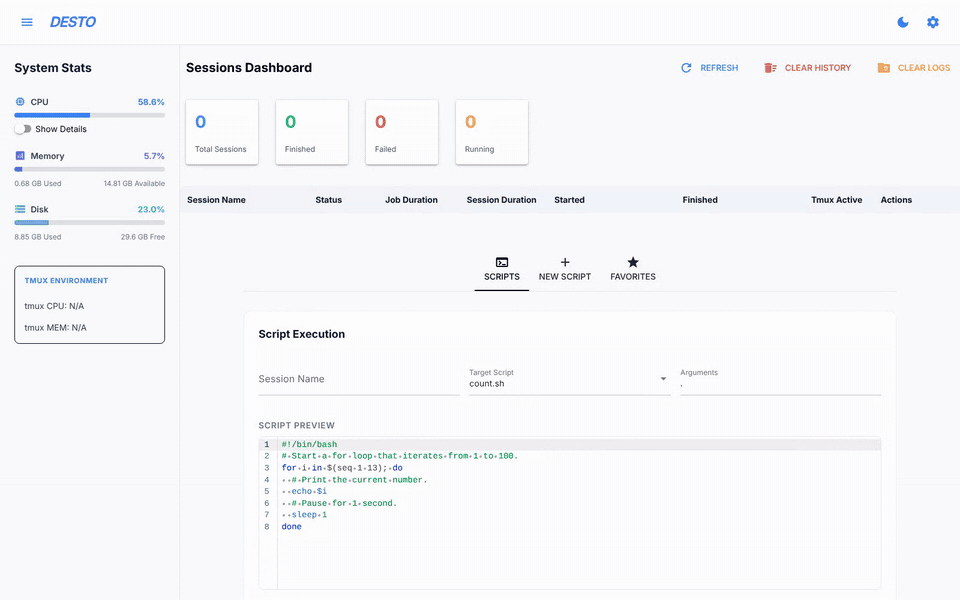
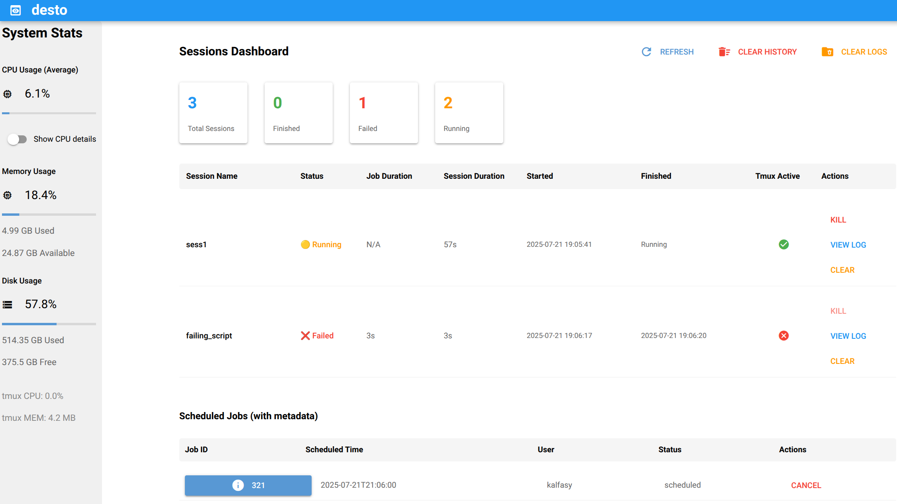
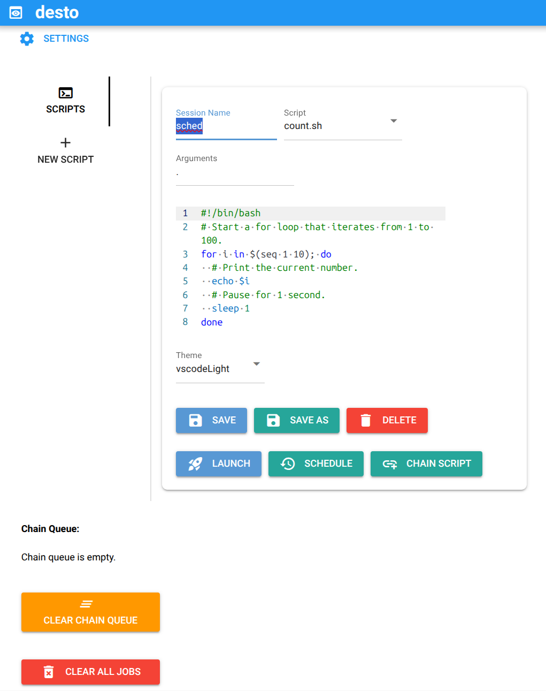
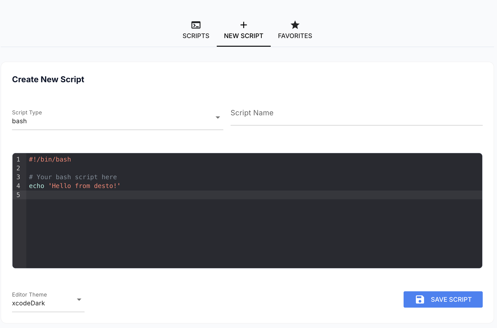
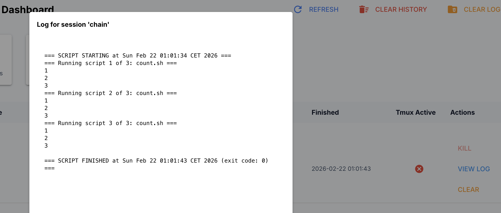
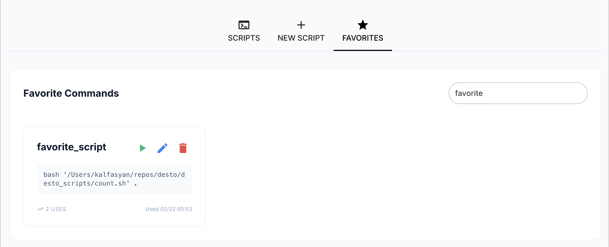
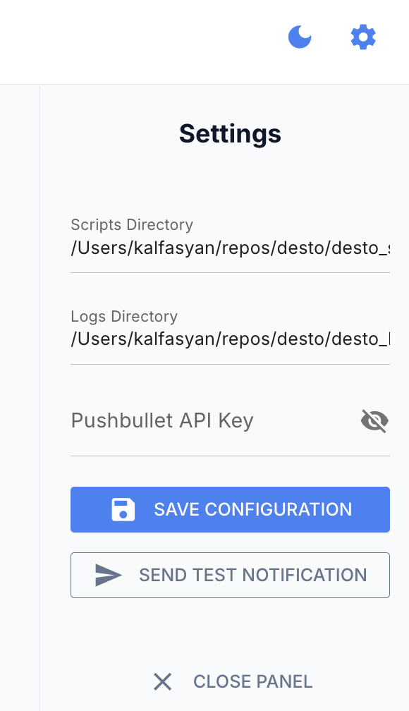
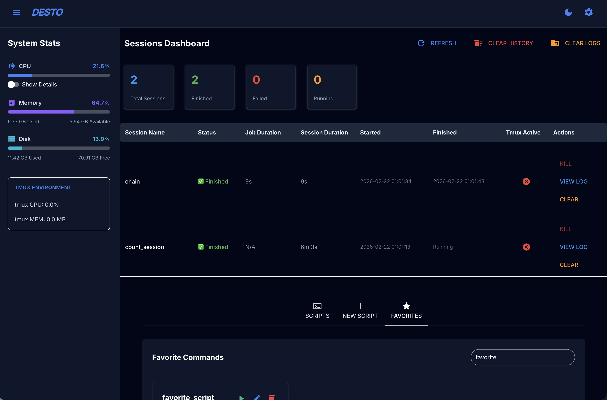

<p align="center">
  
</p>

<h3 align="center">Run your scripts in the background. Watch them from your browser.</h3>

<p align="center">
  <b>desto</b> is a self-hosted web dashboard for launching, monitoring and scheduling bash and Python scripts in <code>tmux</code> sessions.<br/>
  No more <code>ssh</code> → <code>tmux attach</code> → scroll back to see whether your job finished.
</p>

<p align="center">
  <a href="https://badge.fury.io/py/desto"></a>
  <a href="https://pepy.tech/projects/desto"></a>
  <a href="https://desto.readthedocs.io/"></a>
  <a href="https://github.com/kalfasyan/desto/actions/workflows/ci.yml"></a>
  <a href="https://github.com/astral-sh/ruff"></a>
  <a href="https://github.com/PyCQA/bandit"></a>
  <a href="https://github.com/gitleaks/gitleaks-action"></a>
  <a href="https://buymeacoffee.com/kalfasyan"></a>
</p>

<p align="center">
  <a href="#-quick-start">Quick start</a> ·
  <a href="#-features">Features</a> ·
  <a href="#-screenshots">Screenshots</a> ·
  <a href="#-security">Security</a> ·
  <a href="#%EF%B8%8F-command-line-interface">CLI</a> ·
  <a href="https://desto.readthedocs.io/">Docs</a>
</p>

<p align="center">
  
</p>

---

## 🤔 Why desto?

You have a box somewhere (a home server, a VPS, a lab workstation, your laptop) and scripts that take a while: a model training run, a nightly backup, a scraper, a data pipeline. Running them in `tmux` works, but checking on them means logging in, finding the right session and scrolling through output.

desto puts all of that in one page:

- **Start a script in two clicks.** Pick it, name the session, hit *Launch*. It keeps running in `tmux` after you close the tab.
- **See everything at a glance.** Running, finished and failed sessions with exit codes, durations and live system stats.
- **Read logs as they happen.** Open any session's output while it is still running, or long after it finished.
- **Automate the boring parts.** Chain scripts, schedule them for later or on repeat, and get a phone notification when they're done.

## ⚡ Quick start

### 🐳 Docker Compose (recommended)

Comes with Redis included. You only need [Docker](https://docs.docker.com/get-docker/).

```bash
git clone https://github.com/kalfasyan/desto.git && cd desto
docker compose up -d
```

Open **[http://localhost:8809](http://localhost:8809)**. That's it. 🎉

### 🐍 With `uv` or `pip`

You need Python 3.11+, [`tmux`](https://github.com/tmux/tmux), a running [Redis](https://redis.io/docs/latest/operate/oss_and_stack/install/) server, and optionally [`at`](https://en.wikipedia.org/wiki/At_(command)) for scheduling.

```bash
# Debian/Ubuntu (use dnf or pacman on Fedora or Arch)
sudo apt install tmux at redis-server

# Install desto as a tool (gives you both `desto` and `desto-cli`)
uv tool install desto      # or: pip install desto

# Start the dashboard
desto
```

desto creates `desto_scripts/` and `desto_logs/` in the current directory. Drop your `.sh` and `.py` files into `desto_scripts/` and they show up in the dashboard.

More options, including adding desto to an existing `uv` project, are in the [installation guide](https://desto.readthedocs.io/getting-started/installation/).

<details>
<summary><strong>🔄 Start desto automatically on boot (systemd)</strong></summary>

For non-Docker installs, the CLI can install a systemd service:

```bash
# As a user service (recommended)
desto-cli service install

# Or as a system service
sudo desto-cli service install --system
```

Docker Compose users don't need this: the `restart: always` policy already starts desto on boot.
</details>

<details>
<summary><strong>🐳 Handy Docker Compose commands</strong></summary>

```bash
docker compose logs -f           # follow the logs
docker compose up -d --build     # rebuild after pulling changes
docker compose down              # stop and remove the containers
```
</details>

## ✨ Features

| | |
|---|---|
| 🚀 **Run** | Launch bash (`.sh`) and Python (`.py`) scripts as `tmux` sessions. Pass arguments, re-run finished jobs, or kill running ones. |
| ✍️ **Write** | Create, edit, save and delete scripts in a built-in editor with syntax highlighting and bash/Python templates. Or paste what your favorite LLM wrote. 😉 |
| 👀 **Monitor** | A live sessions table with status, exit code, job and session duration, plus CPU, memory and disk usage of the host. |
| 📜 **Logs** | Live-updating log viewer for every session, with download. Logs are kept on disk after the session ends. |
| 🔗 **Chain** | Queue several scripts to run one after another in a single session. |
| ⏰ **Schedule** | Launch a script or chain at a set date and time, once or every N minutes, hours, days or weeks. Cancel scheduled jobs with one click. [Learn more →](https://desto.readthedocs.io/user-guide/scheduling/) |
| ⭐ **Favorites** | Save frequently used commands, search them, and see how often you run each one. [Learn more →](https://desto.readthedocs.io/user-guide/favorites/) |
| 🔔 **Notify** | Optional [Pushbullet](https://www.pushbullet.com/) push to your phone or desktop when a job finishes, with its exit code. Set `DESTO_PUSHBULLET_API_KEY` or add the key in Settings. |
| 🗄️ **History** | Session tracking in [Redis](https://redis.io/about/), plus an optional [SQLite](https://www.sqlite.org/) store that keeps history forever. [Learn more →](https://desto.readthedocs.io/user-guide/sqlite-persistence/) |
| 🔒 **Secure** | Listens on localhost by default, with an optional password login. See [Security](#-security). |
| 🖥️ **CLI** | Everything from the terminal too, with `desto-cli`. See [below](#%EF%B8%8F-command-line-interface). |
| 🌙 **Dark mode** | One click, top right. |

## 📸 Screenshots

<details>
<summary><strong>👀 Dashboard</strong></summary>
<br/>

</details>

<details>
<summary><strong>🚀 Launch a script</strong></summary>
<br/>
Name the session, pick a script, optionally edit it, and click <b>Launch</b>.
<br/><br/>

</details>

<details>
<summary><strong>✍️ Write a new script</strong></summary>
<br/>

</details>

<details>
<summary><strong>📜 View logs</strong></summary>
<br/>

</details>

<details>
<summary><strong>⭐ Favorite commands</strong></summary>
<br/>

</details>

<details>
<summary><strong>⚙️ Settings</strong></summary>
<br/>

</details>

<details>
<summary><strong>🌙 Dark mode</strong></summary>
<br/>

</details>

## 🔒 Security

desto can run any command on the machine it runs on, so treat the dashboard like a shell.

- **Localhost by default.** The dashboard listens on `127.0.0.1`. Set `DESTO_HOST=0.0.0.0` to accept connections from other machines. (Earlier versions listened on all interfaces, so set this to keep that behavior after upgrading.)
- **Password login.** Set `DESTO_PASSWORD` to require a password for every page. A log-out button appears in the header.
- **Startup warning.** desto logs a warning when it is reachable from the network without a password.
- **Use TLS on the internet.** The dashboard serves plain HTTP. Put it behind a reverse proxy that terminates TLS before exposing it beyond your network.

Docker Compose sets `DESTO_HOST=0.0.0.0` inside the container but publishes port 8809 (and Redis on 6380) on `127.0.0.1` only. To open the dashboard to other machines, change the mapping to `"8809:8809"` and uncomment `DESTO_PASSWORD` in `docker-compose.yml`.

## ⚙️ Configuration

The most common settings, all set through environment variables:

| Variable | Default | Description |
|---|---|---|
| `DESTO_HOST` | `127.0.0.1` | Interface to listen on. Use `0.0.0.0` for all interfaces. |
| `DESTO_PORT` | `8809` | Port to listen on. |
| `DESTO_PASSWORD` | *(unset)* | Turns on the login page when set. |
| `DESTO_STORAGE_SECRET` | *(random per start)* | Signs the session cookie. Set a fixed value to stay logged in across restarts. |
| `DESTO_SCRIPTS_DIR` | `./desto_scripts` | Where your scripts live. |
| `DESTO_LOGS_DIR` | `./desto_logs` | Where session logs are written. |
| `REDIS_HOST` / `REDIS_PORT` | `localhost` / `6379` | Redis server to connect to. |
| `SQLITE_ENABLED` | `false` | Keep session history in SQLite as well, so it outlives Redis's 7-day expiry. |
| `DESTO_PUSHBULLET_API_KEY` | *(unset)* | Pushbullet key for finish/fail notifications. |

See the [configuration reference](https://desto.readthedocs.io/reference/configuration/) for the full list.

## 🖥️ Command-line interface

`desto-cli` gives you the dashboard's features in the terminal, with rich formatting and live log following.

<p align="center">
  
</p>

```bash
desto-cli doctor                                         # check tmux, Python and Redis
desto-cli sessions list                                  # list sessions
desto-cli sessions start "my-task" "python my_script.py" # start a command in a new session
desto-cli sessions logs "my-task"                        # view its logs
desto-cli sessions kill "my-task"                        # stop it

desto-cli scripts list                                   # list your scripts
desto-cli scripts create "my_script" --type python       # create a new script
desto-cli scripts edit "my_script"                       # open it in $EDITOR
desto-cli scripts run "my_script"                        # run it in a tmux session
desto-cli scripts run "my_script" --direct               # or run it right here
```

📖 [Full CLI documentation →](https://desto.readthedocs.io/user-guide/cli/)

## 🗺️ Roadmap

- [ ] Pause and resume processes running inside a session

Have an idea? [Open an issue](https://github.com/kalfasyan/desto/issues).

## 🤝 Contributing

Contributions are welcome! Have a look at [CONTRIBUTING.md](CONTRIBUTING.md) to get started, and please report security issues as described in [SECURITY.md](SECURITY.md).

## ☕ Support

If desto saves you some terminal gymnastics, you can [buy me a coffee](https://buymeacoffee.com/kalfasyan).

## 📄 License

[![CC BY 4.0][cc-by-shield]][cc-by]

This work is licensed under a [Creative Commons Attribution 4.0 International License][cc-by].

[cc-by]: http://creativecommons.org/licenses/by/4.0/
[cc-by-shield]: https://img.shields.io/badge/License-CC%20BY%204.0-lightgrey.svg
