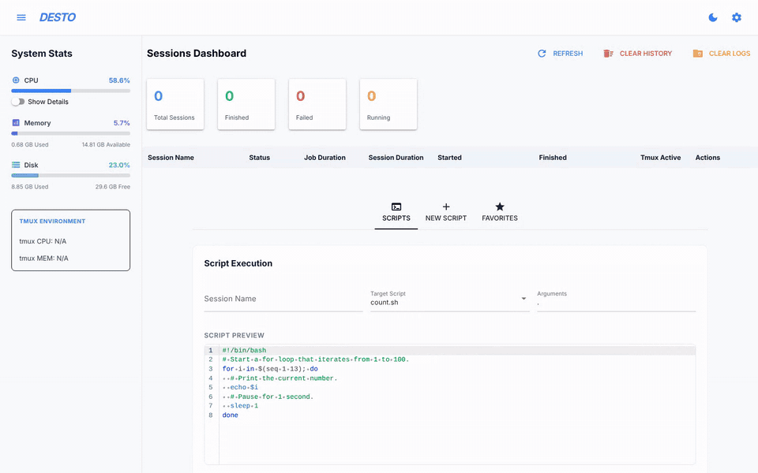
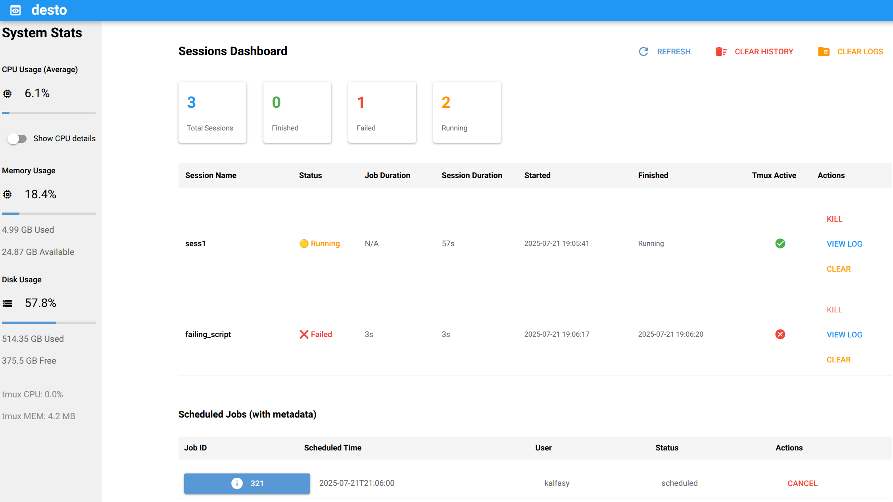
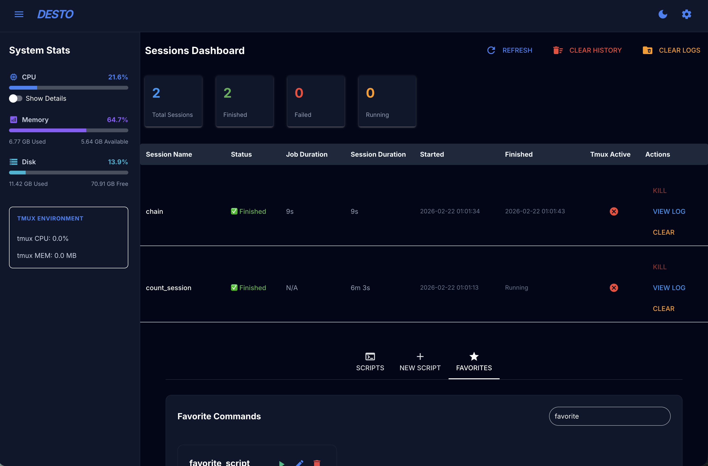
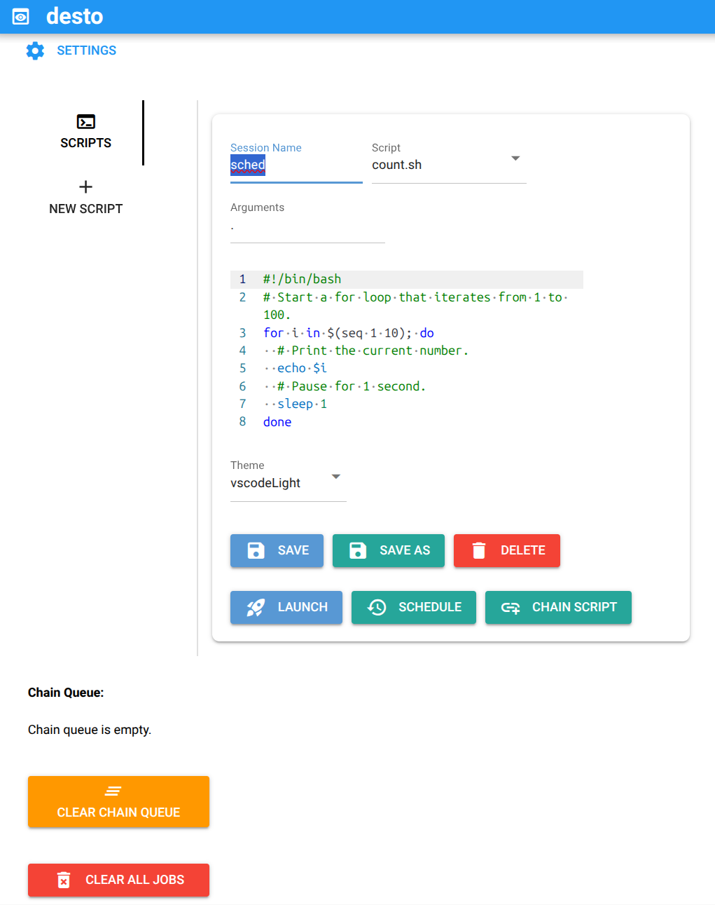
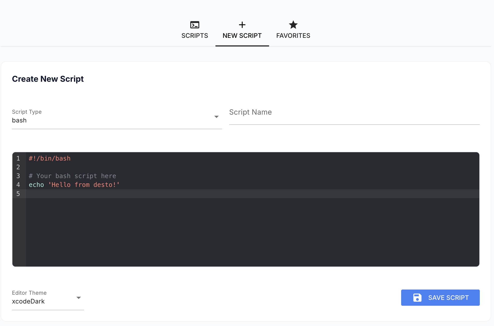
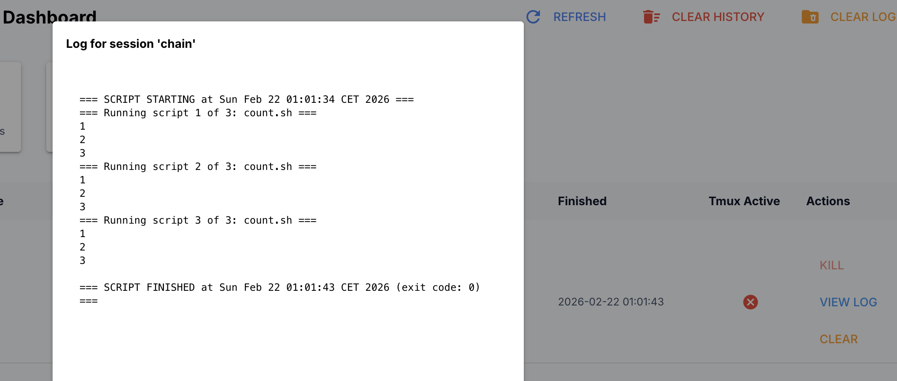
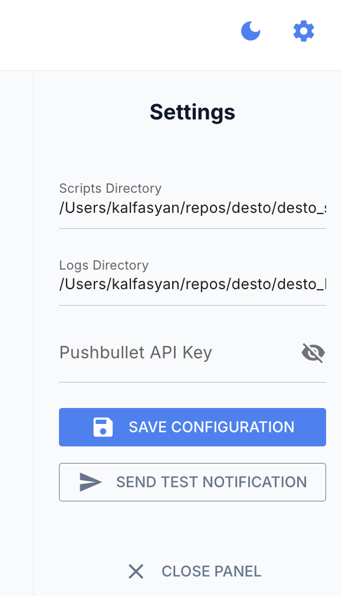
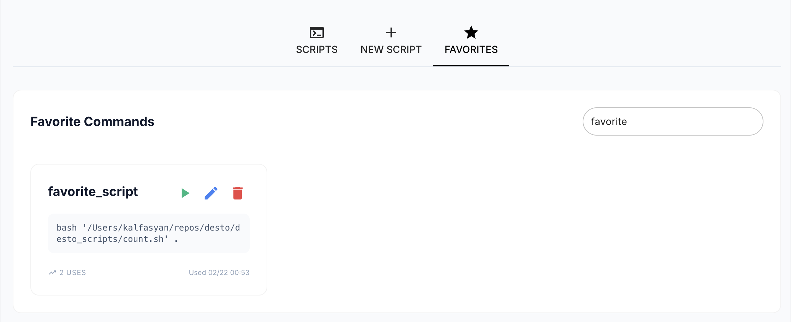
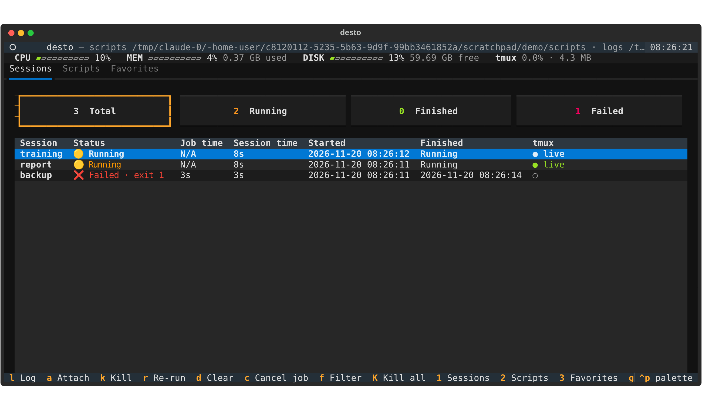

<p align="center">
  
</p>

<h3 align="center">Run your scripts in the background. Watch them from your browser or terminal.</h3>

<p align="center">
  <b>desto</b> is a self-hosted dashboard for launching, monitoring and scheduling bash and Python scripts in <code>tmux</code>.<br/>
  No more <code>ssh</code> → <code>tmux attach</code> → scrolling back to see whether your job finished.
</p>

<p align="center">
  <a href="https://badge.fury.io/py/desto"></a>
  <a href="https://pepy.tech/projects/desto"></a>
  <a href="https://github.com/kalfasyan/desto/actions/workflows/ci.yml"></a>
  <a href="https://desto.readthedocs.io/"></a>
  <a href="https://scorecard.dev/viewer/?uri=github.com/kalfasyan/desto"></a>
  <a href="https://github.com/PyCQA/bandit"></a>
  <a href="https://github.com/gitleaks/gitleaks-action"></a>
  <a href="https://github.com/astral-sh/ruff"></a>
</p>

<p align="center">
  <a href="https://desto-demo.vercel.app"></a>
</p>

<p align="center">
  
</p>

<p align="center">
  <a href="#-quick-start">Quick start</a> ·
  <a href="#-highlights">Highlights</a> ·
  <a href="#-all-features">All features</a> ·
  <a href="#%EF%B8%8F-terminal-ui-and-cli">Terminal UI &amp; CLI</a> ·
  <a href="#-security">Security</a> ·
  <a href="https://desto.readthedocs.io/">Docs</a>
</p>

---

## ⚡ Quick start

```bash
curl -LsSf https://raw.githubusercontent.com/kalfasyan/desto/main/install.sh | sh   # Linux & macOS
desto        # web dashboard at http://localhost:8809
desto-tui    # or the same thing in your terminal
```

The installer sets up everything desto needs (`tmux`, `at`, Redis, `uv`) and then desto itself ([read it first](install.sh) if you like). Drop your `.sh` and `.py` files into `desto_scripts/` and they show up in the dashboard.

<details>
<summary><strong>🐳 Docker Compose</strong></summary>

Everything runs in containers, Redis included. You only need [Docker](https://docs.docker.com/get-docker/).

```bash
git clone https://github.com/kalfasyan/desto.git && cd desto
docker compose up -d                              # dashboard at http://localhost:8809
docker compose exec dashboard uv run desto-tui    # terminal UI inside the container
```

Other handy commands: `docker compose logs -f`, `docker compose up -d --build` (after pulling changes), `docker compose down`.
Uninstall, from inside the `desto` folder (copy out any scripts you want to keep first): `docker compose down -v --rmi all && cd .. && sudo rm -rf desto`
</details>

<details>
<summary><strong>🐍 <code>uv</code> or <code>pip</code></strong></summary>

First install Python 3.11+, `tmux`, `at` and Redis, and make sure Redis is running (on Debian/Ubuntu: `sudo apt install tmux at redis-server`). Then:

```bash
uv tool install desto      # or: pip install desto
```

Uninstall with `uv tool uninstall desto` (or `pip uninstall desto`).
</details>

<details>
<summary><strong>🔄 Start on boot with systemd</strong></summary>

```bash
desto-cli service install            # as a user service (recommended)
sudo desto-cli service install --system
```

Docker Compose doesn't need this: the containers' restart policy already starts desto on boot.
</details>

Source installs, other distros and what each uninstall leaves behind are in the [installation guide](https://desto.readthedocs.io/getting-started/installation/).

## 🌟 Highlights

You have a box somewhere (a home server, a VPS, a lab workstation, your laptop) and scripts that take a while: a training run, a nightly backup, a scraper, a data pipeline. desto turns that box into one page you can check from anywhere.

<table>
<tr>
<td width="50%" valign="top">

### 🚀 Launch in two clicks
Pick a script, name the session, hit *Launch*. It keeps running in `tmux` after you close the tab, and you can re-run, kill or attach to it later.

</td>
<td width="50%" valign="top">

### 📜 Live logs
Follow any session's output as it happens, or read it long after it finished. Logs stay on disk and can be downloaded.

</td>
</tr>
<tr>
<td valign="top">

### 📈 Per-session CPU &amp; memory
See CPU, memory, threads and disk IO for every session's processes, and click to chart them over the whole run. Finished sessions keep their peak memory and CPU time.

</td>
<td valign="top">

### ⏰ Chain &amp; schedule
Queue scripts to run one after another, or start them at a set time, once or on repeat. Get a phone push when they finish.

</td>
</tr>
<tr>
<td valign="top">

### ⌨️ Terminal UI over `ssh`
`desto-tui` is the whole dashboard as a keyboard-driven terminal app, working on the same sessions as the browser. Plus a scriptable `desto-cli`.

</td>
<td valign="top">

### 🔒 Safe by default
Listens on localhost only, with an optional password login and a warning if it's ever reachable without one. Checked by OpenSSF Scorecard, bandit and gitleaks.

</td>
</tr>
</table>

## ✨ All features

| | |
|---|---|
| 🚀 **Run** | Launch bash (`.sh`) and Python (`.py`) scripts as `tmux` sessions, with arguments. Re-run finished jobs or kill running ones. |
| ✍️ **Write** | Create and edit scripts in a built-in editor with syntax highlighting and bash/Python templates. Or paste what your favorite LLM wrote. 😉 |
| 👀 **Monitor** | Live sessions table with status, exit code and durations, plus host CPU, memory and disk. |
| 📈 **Usage** | CPU, memory, threads, CPU time and disk IO per session, sampled every 5 seconds, with history charts that cover long runs. Also tracks `tmux` sessions desto didn't start. |
| 📜 **Logs** | Live-updating log viewer with download, kept after the session ends. |
| 🔗 **Chain** | Run several scripts one after another in a single session. |
| ⏰ **Schedule** | Run a script or chain at a set date and time, once or every N minutes, hours, days or weeks. [Learn more →](https://desto.readthedocs.io/user-guide/scheduling/) |
| ⭐ **Favorites** | Save, search and re-run frequent commands, with usage counts. [Learn more →](https://desto.readthedocs.io/user-guide/favorites/) |
| 🔔 **Notify** | Optional [Pushbullet](https://www.pushbullet.com/) push when a job finishes, with its exit code. |
| 🗄️ **History** | Session tracking in [Redis](https://redis.io/about/), plus optional [SQLite](https://www.sqlite.org/) that keeps history forever. [Learn more →](https://desto.readthedocs.io/user-guide/sqlite-persistence/) |
| 🌙 **Dark mode** | One click, top right. |

<details>
<summary><strong>📸 Screenshots</strong></summary>
<br/>
<table>
<tr>
<td><br/><sub>Dashboard</sub></td>
<td><br/><sub>Dark mode</sub></td>
</tr>
<tr>
<td><br/><sub>Launch a script</sub></td>
<td><br/><sub>Write a new script</sub></td>
</tr>
<tr>
<td><br/><sub>Live logs</sub></td>
<td><br/><sub>Settings</sub></td>
</tr>
<tr>
<td colspan="2"><br/><sub>Favorite commands</sub></td>
</tr>
</table>
</details>

## ⌨️ Terminal UI and CLI

Not in the mood for a browser? `desto-tui` gives you the dashboard in your terminal: launch, chain and schedule scripts, follow logs, attach to a session's `tmux`, and manage favorites. Press `1` `2` `3` to switch between Sessions, Scripts and Favorites, and `?` for every key.

<p align="center">
  
</p>

For scripts and cron jobs, `desto-cli` covers the same ground:

```bash
desto-cli doctor                                         # check tmux, Python and Redis
desto-cli sessions start "my-task" "python my_script.py" # start a command in a new session
desto-cli sessions logs "my-task"                        # view its logs
desto-cli sessions usage                                 # CPU, memory and IO per session
desto-cli scripts run "my_script"                        # run a saved script in tmux
desto-cli monitor                                        # record usage when no dashboard or TUI runs
```

📖 [Terminal UI guide](https://desto.readthedocs.io/user-guide/tui/) · [Full CLI documentation](https://desto.readthedocs.io/user-guide/cli/)

## 🔒 Security

desto can run any command on its machine, so treat the dashboard like a shell.

- **Localhost by default.** It listens on `127.0.0.1`. Set `DESTO_HOST=0.0.0.0` to accept other machines. (Earlier versions listened on all interfaces, so set this to keep that behavior after upgrading.)
- **Password login.** Set `DESTO_PASSWORD` to require a password for every page.
- **Use TLS on the internet.** The dashboard serves plain HTTP, so put a TLS-terminating reverse proxy in front before exposing it.

Docker Compose publishes port 8809 (and Redis on 6380) on `127.0.0.1` only. To open it up, change the mapping to `"8809:8809"` and uncomment `DESTO_PASSWORD` in `docker-compose.yml`.

<details>
<summary><strong>⚙️ Configuration</strong></summary>
<br/>

All settings are environment variables. The most common ones:

| Variable | Default | Description |
|---|---|---|
| `DESTO_HOST` | `127.0.0.1` | Interface to listen on. Use `0.0.0.0` for all interfaces. |
| `DESTO_PORT` | `8809` | Port to listen on. |
| `DESTO_PASSWORD` | *(unset)* | Turns on the login page when set. |
| `DESTO_STORAGE_SECRET` | *(random per start)* | Signs the session cookie. Set a fixed value to stay logged in across restarts. |
| `DESTO_SCRIPTS_DIR` | `./desto_scripts` | Where your scripts live. |
| `DESTO_LOGS_DIR` | `./desto_logs` | Where session logs are written. |
| `REDIS_HOST` / `REDIS_PORT` | `localhost` / `6379` | Redis server to connect to. |
| `SQLITE_ENABLED` | `false` | Keep session history in SQLite as well, so it outlives Redis's 7-day expiry. |
| `DESTO_PUSHBULLET_API_KEY` | *(unset)* | Pushbullet key for finish/fail notifications (also settable in Settings). |
| `DESTO_METRICS_ENABLED` | `true` | Record CPU, memory and IO of each session. |
| `DESTO_METRICS_INTERVAL` | `5` | Seconds between usage samples. |

See the [configuration reference](https://desto.readthedocs.io/reference/configuration/) for the full list.
</details>

## 🤝 Contributing

Ideas, bug reports and pull requests are welcome. Next on the [roadmap](https://github.com/kalfasyan/desto/issues): pausing and resuming processes inside a session. See [CONTRIBUTING.md](CONTRIBUTING.md) to get started, and report security issues as described in [SECURITY.md](SECURITY.md).

If desto saves you some terminal gymnastics, a ⭐ on GitHub or a [coffee](https://buymeacoffee.com/kalfasyan) is much appreciated.

## 📄 License

[![CC BY 4.0][cc-by-shield]][cc-by]

This work is licensed under a [Creative Commons Attribution 4.0 International License][cc-by].

[cc-by]: http://creativecommons.org/licenses/by/4.0/
[cc-by-shield]: https://img.shields.io/badge/License-CC%20BY%204.0-lightgrey.svg
