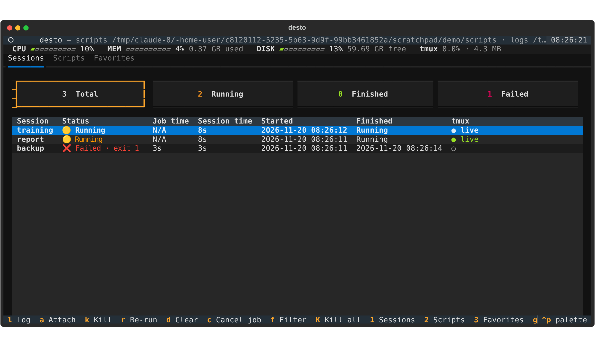

# Terminal UI

`desto-tui` is the desto dashboard in your terminal. It does the same jobs as the web dashboard (launch, chain, schedule, follow logs, kill, re-run, favorites) without a browser, which is handy over `ssh`.



## Start it

```bash
desto-tui
```

It needs the same things as the web dashboard: `tmux`, a running Redis server and, for scheduling, `at`. It reads the same environment variables (`DESTO_SCRIPTS_DIR`, `DESTO_LOGS_DIR`, `REDIS_HOST`, `REDIS_PORT`, `SQLITE_ENABLED`, ...), so the web dashboard, the CLI and the terminal UI can run side by side and see the same sessions.

## Tabs and keys

Press `?` at any time to see every key for the part of the screen you are in, and `ctrl+p` for the command palette (which also switches color themes).

| Key | Anywhere |
|---|---|
| `1` `2` `3` | Sessions, Scripts and Favorites tabs |
| `g` | Show or hide desto's own log |
| `q` | Quit |

**Sessions**: the counts, a sessions table and, when there are any, the scheduled jobs.

| Key | Action |
|---|---|
| `enter` / `l` | Follow the session's log live (`f` pauses following, `esc` closes) |
| `a` | Attach to the session's tmux session (detach with `ctrl+b d` to come back) |
| `k` | Kill the running session |
| `r` | Re-run a finished or failed session's command in a new session |
| `d` | Clear the session: delete its log and its record |
| `c` | Cancel the selected scheduled job (or its whole recurring schedule) |
| `f` | Filter by running, finished or failed (or click a count) |
| `K` / `H` / `L` | Kill everything, clear history, delete all log files |

**Scripts**: pick a script on the left; it opens in an editor with syntax highlighting.

| Key | Action |
|---|---|
| `ctrl+r` | Launch the script (or the chain) as the named session |
| `ctrl+t` | Schedule it: a date and time, once or every N minutes, hours, days or weeks |
| `ctrl+b` | Add the script with its arguments to the chain |
| `ctrl+s` | Save your edits (launching with unsaved edits is refused) |
| `ctrl+n` | New script from a bash or Python template |

The buttons under the editor do the same, plus *Save as…*, *★ Favorite* and *Delete*.

**Favorites**: `enter` runs the favorite in a new `fav-<name>` session, `/` searches, `n` adds, `e` edits, `d` deletes and `D` deletes all of them.

## How it is built

The terminal UI is a thin [Textual](https://textual.textualize.io/) front end. Everything it does goes through `desto.core.service.DestoService`, the same class the web dashboard uses, so launching, scheduling and clean-up behave identically in both:

```
src/desto/
├── core/            # UI-independent: shared by the web dashboard, the TUI and the CLI
│   ├── service.py   # DestoService: tmux sessions, Redis tracking, favorites, clean-up
│   ├── scheduled_jobs.py  # scheduling with `at`, recurring schedules, cancelling
│   ├── scripts.py   # listing scripts, templates, the commands that run them
│   ├── formatting.py      # session and scheduled-job table rows
│   ├── log_tailer.py      # following a growing log file
│   └── system_stats.py    # CPU, memory, disk and tmux usage
├── app/             # the web dashboard (NiceGUI)
└── tui/             # the terminal UI (Textual)
    ├── app.py       # DestoApp: tabs, timers, entry point
    ├── sessions.py, scripts.py, favorites.py   # one pane per tab
    ├── modals.py    # confirm, form, schedule and log screens
    └── desto.tcss   # styles
```
